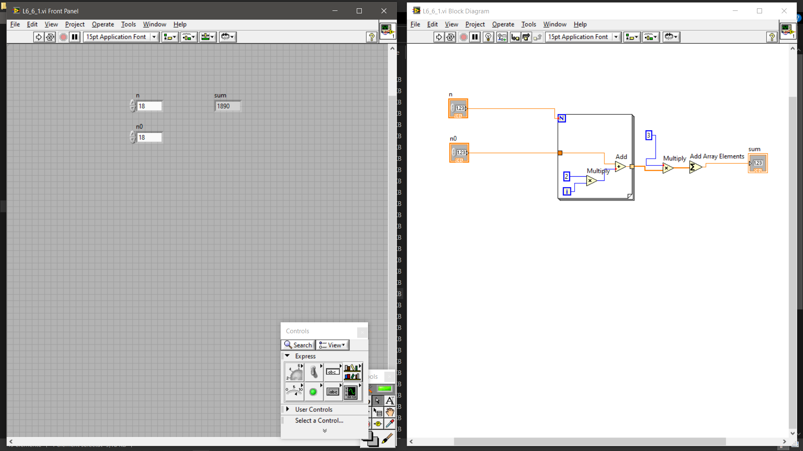
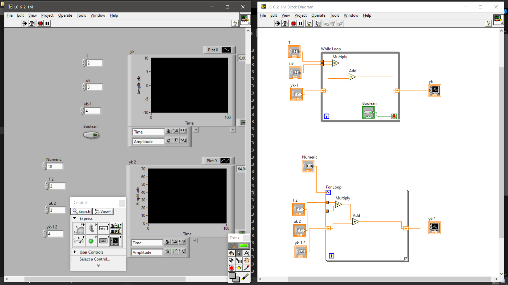
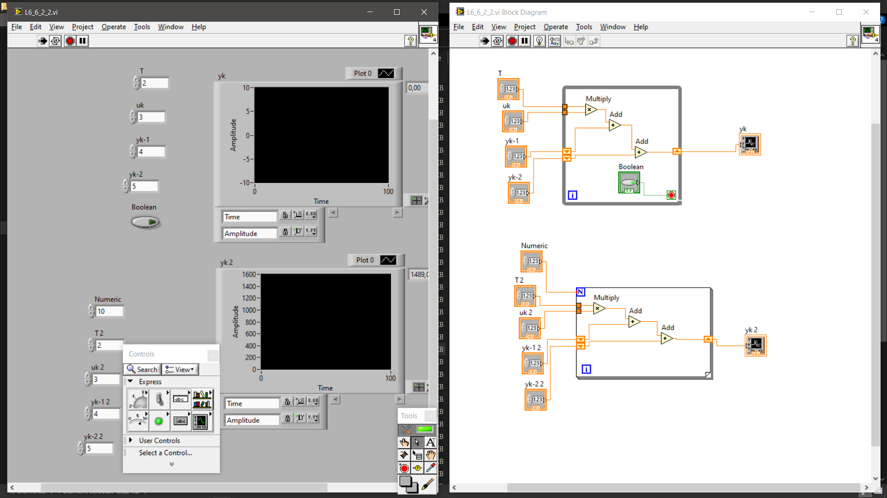
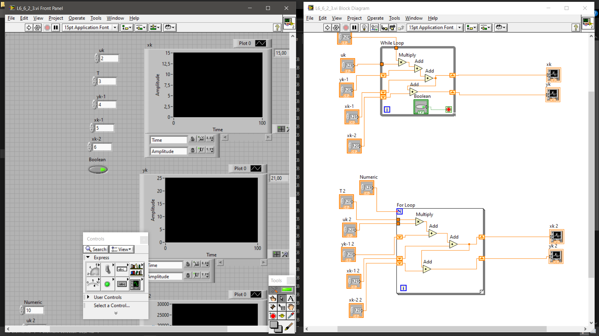
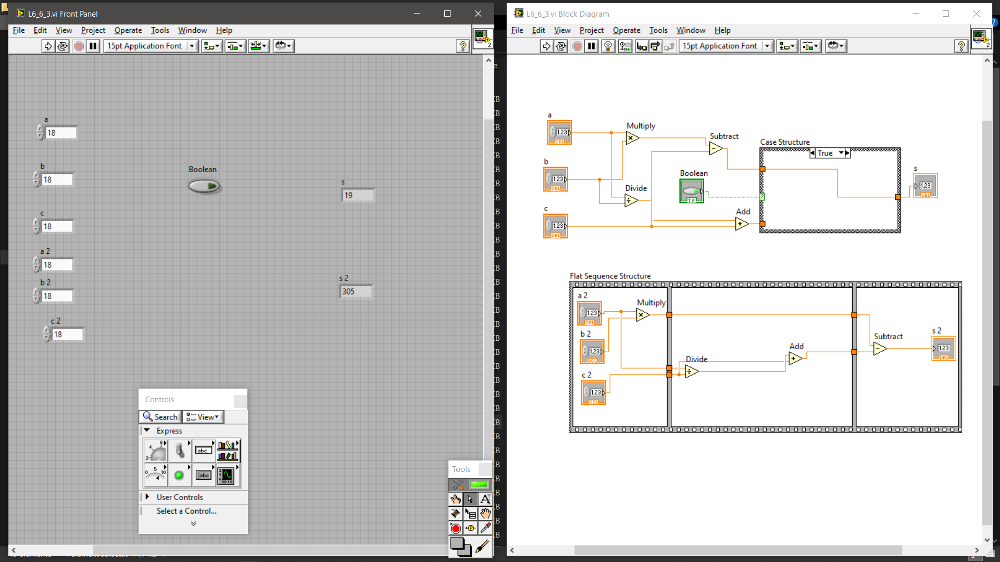
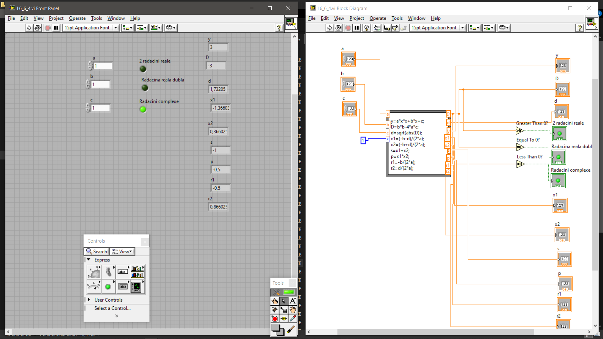

# Aplicații și algoritmi în LabVIEW
**LabVIEW Applications and Algorithms**

# 🇷🇴 Română

## Despre proiect

Acest proiect prezintă o colecție de șase aplicații dezvoltate în **LabVIEW**, care demonstrează utilizarea programării grafice pentru implementarea algoritmilor matematici, a structurilor de control, a calculelor iterative și a reprezentării grafice a datelor.

Proiectul evidențiază construirea diagramelor bloc, prelucrarea datelor și utilizarea structurilor și funcțiilor disponibile în mediul LabVIEW.

## Aplicații dezvoltate

### 1. L6_6_1.vi – Generarea și prelucrarea unei secvențe numerice

**Scop:** Generarea unei secvențe numerice pe baza unei valori inițiale și calcularea sumei elementelor rezultate.

Aplicația utilizează o structură For Loop pentru generarea unei secvențe de valori pornind de la o valoare inițială n0.

La fiecare iterație se efectuează operații aritmetice asupra indexului buclei și valorii inițiale. Valorile rezultate sunt colectate într-un tablou, iar suma acestora este calculată folosind funcția Add Array Elements.

**Implementare:**
- Utilizarea structurii `For Loop` pentru generarea secvenței.
- Calcularea valorilor pe baza indexului iterației și a parametrului inițial `n0`.
- Aplicarea operațiilor aritmetice asupra fiecărui element.
- Construirea unui array cu valorile calculate.
- Utilizarea funcției `Add Array Elements` pentru determinarea sumei.

**Relații matematice:**

Pentru fiecare iterație \(i\), se calculează:

\[
a_i = 2i+n_0
\]

\[
x_i = 3a_i = 3(2i+n_0)
\]

Suma elementelor generate este:

\[
S=\sum_{i=0}^{n-1}x_i
\]

**Concepte LabVIEW:** For Loop, terminal de iterație, operații aritmetice, array-uri și Add Array Elements.

**Captură de ecran:**



---

### 2. L6_6_2_1.vi – Implementarea unei relații de recurență de ordinul întâi

**Scop:** Calcularea valorilor unei secvențe numerice folosind o relație de recurență de ordinul întâi.

Aplicația implementează calculul unei succesiuni de valori folosind o relație recursivă de ordinul întâi:

yk = T × uk + yk-1

Sunt prezentate două variante de implementare, utilizând structurile While Loop și For Loop. Valorile calculate sunt transmise către indicatoare grafice pentru vizualizarea evoluției acestora.

**Implementare:**
- Calcularea termenilor conform relației de recurență.
- Utilizarea structurilor `While Loop` și `For Loop` pentru controlul execuției iterative.
- Preluarea valorii calculate anterior pentru determinarea termenului următor.
- Reprezentarea grafică a valorilor obținute.

**Relația matematică:**

\[
y_k=T\cdot u_k+y_{k-1}
\]

unde:
- \(T\) – parametrul de calcul;
- \(u_k\) – valoarea de intrare;
- \(y_{k-1}\) – valoarea precedentă;
- \(y_k\) – valoarea calculată la iterația curentă.

Aplicația include implementări iterative ale relației, folosind parametrii de intrare corespunzători.

**Concepte LabVIEW:** While Loop, For Loop, registre de deplasare, calcule iterative și Waveform Graph.

**Captură de ecran:**



---

### 3. L6_6_2_2.vi – Implementarea unei relații de recurență de ordinul al doilea

**Scop:** Calcularea unei secvențe numerice în care fiecare termen depinde de valorile termenilor anteriori.

Aplicația extinde calculul recursiv prin utilizarea a două valori anterioare. Fiecare termen este determinat în funcție de intrarea uk, perioada T și valorile precedente yk-1 și yk-2.

Calculul este implementat folosind atât While Loop, cât și For Loop, iar rezultatele sunt reprezentate grafic.

**Implementare:**
- Utilizarea unei relații de recurență de ordinul al doilea.
- Implementarea calculelor iterative cu ajutorul structurilor `While Loop` și `For Loop`.
- Păstrarea celor două valori anterioare necesare calculării termenului curent.
- Reprezentarea grafică a rezultatelor.

**Relația matematică:**

\[
y_k=T\cdot u_k+y_{k-1}+y_{k-2}
\]

unde:
- \(T\) – parametrul de calcul;
- \(u_k\) – valoarea de intrare;
- \(y_{k-1}\), \(y_{k-2}\) – cei doi termeni precedenți;
- \(y_k\) – termenul curent.

**Concepte LabVIEW:** While Loop, For Loop, registre de deplasare, recurențe numerice și reprezentare grafică.

**Captură de ecran:**



---

### 4. L6_6_2_3.vi – Calculul a două secvențe interdependente

**Scop:** Implementarea a două calcule recursive ale căror rezultate sunt interdependente.

Aplicația implementează două calcule recursive interdependente, utilizând valorile anterioare ale variabilelor xk și yk.

Sunt utilizate structurile While Loop și For Loop pentru efectuarea calculelor iterative. Rezultatele celor două variabile sunt afișate în grafice separate.

**Implementare:**
- Calcularea succesivă a valorilor \(x_k\) și \(y_k\).
- Utilizarea valorilor anterioare ale celor două secvențe în calculele curente.
- Organizarea calculelor în structuri `While Loop` și `For Loop`.
- Reprezentarea grafică separată a celor două secvențe.

**Relațiile matematice:**

\[
x_k=T\cdot u_k+y_{k-1}+x_{k-1}
\]

\[
y_k=y_{k-1}+x_{k-1}
\]

unde:
- \(T\) – parametrul de calcul;
- \(u_k\) – valoarea de intrare;
- \(x_{k-1}\), \(y_{k-1}\) – valorile precedente;
- \(x_k\), \(y_k\) – valorile curente ale celor două secvențe.

**Concepte LabVIEW:** bucle iterative, registre de deplasare, calcule recursive și Waveform Graph.

**Captură de ecran:**



---

### 5. L6_6_3.vi – Structuri de control și execuție secvențială

**Scop:** Demonstrarea utilizării structurilor de control pentru selectarea și executarea unor operații diferite.

Aplicația prezintă două modalități de organizare a operațiilor aritmetice.

Prima implementare utilizează o structură Case Structure, controlată printr-o valoare booleană, pentru selectarea operației corespunzătoare.

A doua implementare folosește o structură Flat Sequence Structure, care permite executarea operațiilor în cadre succesive.

**Implementare:**
- Utilizarea structurii `Case Structure`, controlată printr-o variabilă Boolean, pentru selectarea ramurii de execuție.
- Implementarea operațiilor aritmetice în funcție de cazul selectat.
- Utilizarea structurii `Flat Sequence Structure` pentru executarea operațiilor în ordine secvențială.

**Logică de execuție:**

Selectarea operației se realizează în funcție de valoarea variabilei Boolean:

\[
R=
\begin{cases}
R_1, & \text{dacă } B=\text{True}\\
R_2, & \text{dacă } B=\text{False}
\end{cases}
\]

*Notă: \(R_1\) și \(R_2\) reprezintă rezultatele ramurilor condiționale, nu formule aritmetice suplimentare.*

**Concepte LabVIEW:** Boolean Control, Case Structure, Flat Sequence Structure și operații aritmetice.

**Captură de ecran:**



---

### 6. L6_6_4.vi – Rezolvarea ecuației de gradul al doilea

**Scop:** Determinarea rădăcinilor unei ecuații de gradul al doilea pe baza coeficienților introduși.

Ecuația analizată este:

\[
ax^2+bx+c=0
\]

Aplicația permite rezolvarea ecuației de gradul al doilea pe baza coeficienților a, b și c.

Calculul este realizat folosind un Formula Node, care determină discriminantul și rădăcinile ecuației.

În funcție de valoarea discriminantului, aplicația identifică situațiile în care ecuația are două rădăcini reale distincte, o rădăcină reală dublă sau rădăcini complexe.

Sunt afișate și alte rezultate, precum suma și produsul rădăcinilor.

**Implementare:**
- Introducerea coeficienților \(a\), \(b\) și \(c\).
- Utilizarea unui `Formula Node` pentru efectuarea calculelor matematice.
- Calcularea discriminantului.
- Determinarea rădăcinilor și clasificarea acestora.
- Calcularea sumei și produsului rădăcinilor.

**Relații matematice:**

Discriminantul:

\[
D=b^2-4ac
\]

Valoarea utilizată pentru calculul rădăcinilor:

\[
d=\sqrt{|D|}
\]

Rădăcinile calculate de aplicație:

\[
x_1=\frac{-b-d}{2a}
\]

\[
x_2=\frac{-b+d}{2a}
\]

Suma și produsul rădăcinilor:

\[
s=x_1+x_2
\]

\[
p=x_1\cdot x_2
\]

Pentru cazul rădăcinilor complexe, sunt calculate și componentele:

\[
r_1=\frac{-b}{2a}
\]

\[
r_2=\frac{d}{2a}
\]

**Clasificarea soluțiilor în funcție de discriminant:**

- \(D>0\): două rădăcini reale distincte;
- \(D=0\): o rădăcină reală dublă;
- \(D<0\): două rădăcini complexe conjugate.

În cazul complex, rădăcinile sunt:

\[
x_{1,2}=r_1\mp i r_2
\]

**Concepte LabVIEW:** Formula Node, expresii matematice, operații numerice și comparații condiționale.

**Captură de ecran:**



---

## Tehnologii și concepte demonstrate

- **LabVIEW** – programare grafică.
- **For Loop și While Loop** – execuție iterativă.
- **Case Structure** – control condițional.
- **Flat Sequence Structure** – execuție secvențială.
- **Shift Registers** – păstrarea valorilor între iterații.
- **Array Operations** – stocarea și prelucrarea datelor.
- **Formula Node** – implementarea expresiilor matematice.
- **Waveform Graph** – reprezentarea grafică a rezultatelor.
- **Recursive Algorithms** – implementarea relațiilor de recurență.

## Structura proiectului

```text
labview-aplicatii-si-algoritmi/
│
├── aplicatii/
│   ├── L6_6_1.vi
│   ├── L6_6_2_1.vi
│   ├── L6_6_2_2.vi
│   ├── L6_6_2_3.vi
│   ├── L6_6_3.vi
│   └── L6_6_4.vi
│
├── capturi/
│   ├── L6-1.png
│   ├── L6-2-1.png
│   ├── L6-2-2.png
│   ├── L6-2-3.png
│   ├── L6-3.png
│   └── L6-4.png
│
└── README.md
```

## Cum se utilizează

1. Instalați NI LabVIEW.

2. Descărcați sau clonați repository-ul.

3. Deschideți fișierul .vi dorit în LabVIEW.

4. Configurați valorile de intrare din Front Panel.

5. Rulați aplicația și analizați rezultatele.

---

# 🇬🇧 English

## About the Project

This Project contains a collection of six applications developed in **LabVIEW**, demonstrating graphical programming through mathematical algorithms, control structures, iterative calculations, and data visualization.

The project highlights block diagram development, data processing, and the use of various structures and functions available in the LabVIEW environment.

## Developed Applications

### 1. L6_6_1.vi – Numerical Sequence Generation and Processing

**Purpose:** Generate a numerical sequence based on an initial value and calculate the sum of its elements.

This application uses a For Loop to generate a sequence of values starting from an initial value n0.

At each iteration, arithmetic operations are performed using the loop iteration index and the initial value. The resulting values are collected into an array, and their total sum is calculated using the Add Array Elements function.

**Implementation:**
- Use a `For Loop` to generate the sequence.
- Calculate values based on the iteration index and the initial parameter `n0`.
- Apply arithmetic operations to each element.
- Build an array containing the calculated values.
- Use the `Add Array Elements` function to calculate the sum.

**Mathematical equations:**

For each iteration \(i\):

\[
a_i=2i+n_0
\]

\[
x_i=3a_i=3(2i+n_0)
\]

The sum of the generated elements is:

\[
S=\sum_{i=0}^{n-1}x_i
\]

**LabVIEW Concepts:** For Loop, iteration terminal, arithmetic operations, arrays, and Add Array Elements.

**Screenshot:**


---

### 2. L6_6_2_1.vi – First-Order Recurrence Relation

**Purpose:** Calculate the values of a numerical sequence using a first-order recurrence relation.

This application implements the calculation of a sequence using a first-order recurrence relationship:

yk = T × uk + yk-1

Two implementation approaches are provided using While Loop and For Loop structures. The calculated values are sent to graph indicators to visualize their progression.

**Implementation:**
- Calculate sequence terms according to the recurrence relation.
- Use `While Loop` and `For Loop` structures for iterative execution.
- Use the previously calculated value to determine the next term.
- Display the resulting values graphically.

**Mathematical equation:**

\[
y_k=T\cdot u_k+y_{k-1}
\]

where:
- \(T\) – calculation parameter;
- \(u_k\) – input value;
- \(y_{k-1}\) – previous value;
- \(y_k\) – current value.

The application includes iterative implementations of this relation using the corresponding input parameters.

**LabVIEW Concepts:** While Loop, For Loop, shift registers, iterative calculations, and Waveform Graph.

**Screenshot:**


---

### 3. L6_6_2_2.vi – Second-Order Recurrence Relation

**Purpose:** Calculate a numerical sequence in which each term depends on the two previous terms.

This application extends the recursive calculation by using two previous values. Each term is calculated based on the input uk, the period T, and the previous values yk-1 and yk-2.

The calculation is implemented using both While Loop and For Loop structures, with graphical representation of the results.

**Implementation:**
- Use a second-order recurrence relation.
- Implement iterative calculations using `While Loop` and `For Loop` structures.
- Retain the two previous values required to calculate the current term.
- Display the results graphically.

**Mathematical equation:**

\[
y_k=T\cdot u_k+y_{k-1}+y_{k-2}
\]

where:
- \(T\) – calculation parameter;
- \(u_k\) – input value;
- \(y_{k-1}\), \(y_{k-2}\) – previous terms;
- \(y_k\) – current term.

**LabVIEW Concepts:** While Loop, For Loop, shift registers, numerical recurrence relations, and graphical representation.

**Screenshot:**


---

### 4. L6_6_2_3.vi – Calculation of Two Interdependent Sequences

**Purpose:** Implement two recursive calculations whose results are interdependent.

This application implements two interdependent recursive calculations using the previous values of variables xk and yk.

Both While Loop and For Loop structures are used to perform iterative calculations. The results of the two variables are displayed in separate graphs.

**Implementation:**
- Sequentially calculate the values \(x_k\) and \(y_k\).
- Use previous values from both sequences in the current calculations.
- Organize the calculations using `While Loop` and `For Loop` structures.
- Display the two sequences in separate graphs.

**Mathematical equations:**

\[
x_k=T\cdot u_k+y_{k-1}+x_{k-1}
\]

\[
y_k=y_{k-1}+x_{k-1}
\]

where:
- \(T\) – calculation parameter;
- \(u_k\) – input value;
- \(x_{k-1}\), \(y_{k-1}\) – previous values;
- \(x_k\), \(y_k\) – current values of the two sequences.

**LabVIEW Concepts:** Iterative loops, shift registers, recursive calculations, and Waveform Graph.

**Screenshot:**


---

### 5. L6_6_3.vi – Control Structures and Sequential Execution

**Purpose:** Demonstrate the use of control structures to select and execute different operations.

This application demonstrates two approaches to organizing arithmetic operations.

The first implementation uses a Case Structure, controlled by a Boolean value, to select the appropriate operation.

The second implementation uses a Flat Sequence Structure, allowing operations to be executed in successive frames.

**Implementation:**
- Use a `Case Structure`, controlled by a Boolean variable, to select the execution branch.
- Implement arithmetic operations according to the selected case.
- Use a `Flat Sequence Structure` to execute operations in a defined sequence.

**Execution logic:**

The selected operation depends on the Boolean variable:

\[
R=
\begin{cases}
R_1, & \text{if } B=\text{True}\\
R_2, & \text{if } B=\text{False}
\end{cases}
\]

*Note: \(R_1\) and \(R_2\) represent the outputs of the conditional branches, not additional arithmetic formulas.*

**LabVIEW Concepts:** Boolean Control, Case Structure, Flat Sequence Structure, and arithmetic operations.

**Screenshot:**


---

### 6. L6_6_4.vi – Quadratic Equation Solver

**Purpose:** Determine the roots of a quadratic equation based on the input coefficients.

The equation is:

\[
ax^2+bx+c=0
\]

This application solves quadratic equations using the coefficients a, b, and c.

The calculations are performed using a Formula Node, which determines the discriminant and the equation's roots.

Based on the discriminant value, the application identifies whether the equation has two distinct real roots, one repeated real root, or complex roots.

Additional results, including the sum and product of the roots, are also displayed.

**Implementation:**
- Input the coefficients \(a\), \(b\), and \(c\).
- Use a `Formula Node` to perform mathematical calculations.
- Calculate the discriminant.
- Determine and classify the roots.
- Calculate the sum and product of the roots.

**Mathematical equations:**

Discriminant:

\[
D=b^2-4ac
\]

Value used to calculate the roots:

\[
d=\sqrt{|D|}
\]

Calculated roots:

\[
x_1=\frac{-b-d}{2a}
\]

\[
x_2=\frac{-b+d}{2a}
\]

Sum and product of the roots:

\[
s=x_1+x_2
\]

\[
p=x_1\cdot x_2
\]

For complex roots, the following components are calculated:

\[
r_1=\frac{-b}{2a}
\]

\[
r_2=\frac{d}{2a}
\]

**Root classification based on the discriminant:**

- \(D>0\): two distinct real roots;
- \(D=0\): one repeated real root;
- \(D<0\): two complex conjugate roots.

For the complex case:

\[
x_{1,2}=r_1\mp i r_2
\]

**LabVIEW Concepts:** Formula Node, mathematical expressions, numerical operations, and conditional comparisons.

**Screenshot:**


---

## Technologies and Concepts Demonstrated

- **LabVIEW** – graphical programming.
- **For Loop and While Loop** – iterative execution.
- **Case Structure** – conditional control.
- **Flat Sequence Structure** – sequential execution.
- **Shift Registers** – retaining values between iterations.
- **Array Operations** – data storage and processing.
- **Formula Node** – mathematical expression implementation.
- **Waveform Graph** – graphical result visualization.
- **Recursive Algorithms** – recurrence relation implementation.

## Project Structure

```text
labview-aplicatii-si-algoritmi/
│
├── aplicatii/
│   ├── L6_6_1.vi
│   ├── L6_6_2_1.vi
│   ├── L6_6_2_2.vi
│   ├── L6_6_2_3.vi
│   ├── L6_6_3.vi
│   └── L6_6_4.vi
│
├── capturi/
│   ├── L6-1.png
│   ├── L6-2-1.png
│   ├── L6-2-2.png
│   ├── L6-2-3.png
│   ├── L6-3.png
│   └── L6-4.png
│
└── README.md
```

## How to Use

1. Install NI LabVIEW.

2. Download or clone this repository.

3. Open the desired .vi file in LabVIEW.

4. Configure the input values in the Front Panel.

5. Run the application and analyze the results.

---

## 👤 Autor / Author

**IonutD**
